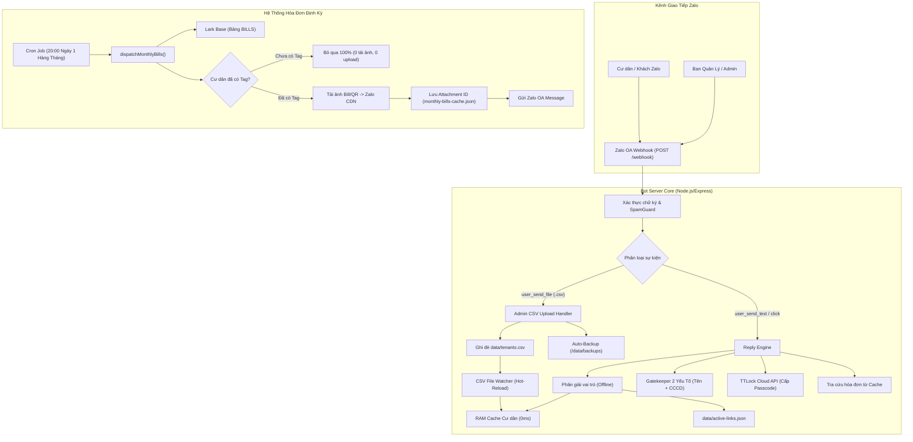
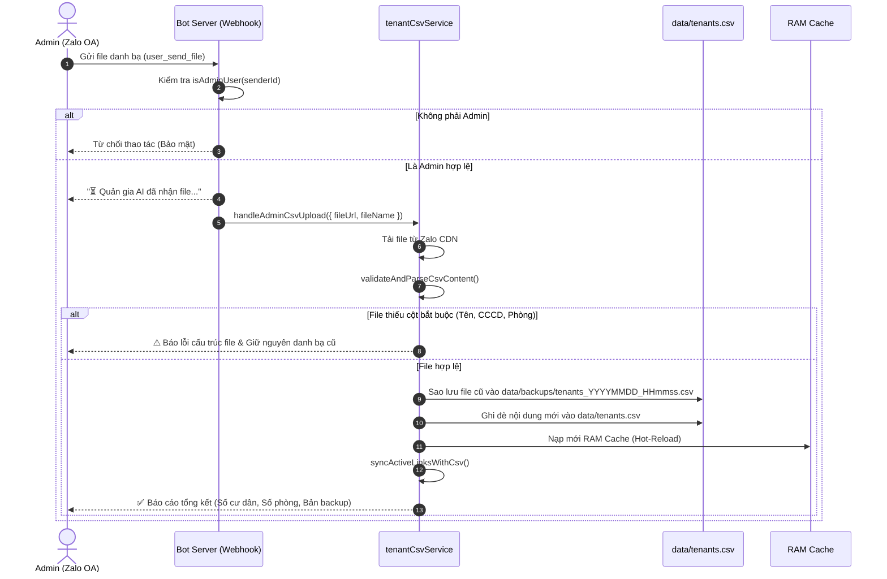

# TÀI LIỆU KIẾN TRÚC HỆ THỐNG ZALO OA BOT QUẢN GIA TÒA NHÀ
> **Phiên bản:** 2.0 (Kiến trúc Offline-First & Quota-Optimized)  
> **Cập nhật ngày:** 02/11/2026  
> **Dự án:** Quản gia AI Tòa nhà 38 Phan Bá Vành (`38PBV`)

---

## 1. TỔNG QUAN KIẾN TRÚC (HIGH-LEVEL ARCHITECTURE)

Hệ thống được thiết kế theo mô hình **Hybrid Event-Driven Architecture** kết hợp giữa phản hồi thời gian thực qua Webhook Zalo OA, bộ đệm RAM cực nhanh (0ms), cơ chế phân quyền bảo mật 2 lớp, và bảo vệ Quota API Lark Base.



---

## 2. KIẾN TRÚC QUẢN LÝ CƯ DÂN OFFLINE & BỘ CATCH RAM THÔNG MINH

### 2.1. Độc lập hoàn toàn với Lark Base
Để tiết kiệm quota hàng tháng của Lark Base (`99991403 Quota Exceeded`), toàn bộ dữ liệu cư dân được vận hành độc lập qua file [`data/tenants.csv`](file:///D:/Học%20tập/thenewzalooa/chatbot/data/tenants.csv) và [`data/active-links.json`](file:///D:/Học%20tập/thenewzalooa/chatbot/data/active-links.json):
* **0 lượt gọi API Lark Base** cho mọi thao tác: tìm kiếm cư dân, kiểm tra hợp đồng, tra cứu số phòng, xác minh danh tính.
* Bot tra cứu cục bộ đạt độ trễ xấp xỉ **0ms**.

### 2.2. RAM Cache Thông Minh (Smart Catch)
* File CSV được nạp vào bộ nhớ RAM ngay khi server khởi động qua hàm `loadTenantsFromCsv()`.
* **Cơ chế kiểm tra mtime & size**: Trước mỗi lần tra cứu, bot kiểm tra `stat.mtimeMs` và `stat.size`. Nếu file trên đĩa không thay đổi, hàm trả về mảng dữ liệu trong RAM ngay lập tức, triệt tiêu 100% thao tác đọc đĩa (Disk I/O).

### 2.3. Smart File Watcher (Hot-Reload)
* Sử dụng `fs.watchFile(TENANTS_CSV_FILE, { interval: 2000 })` để theo dõi file CSV.
* Bất cứ khi nào file `tenants.csv` được ghi mới hoặc thay thế, watcher tự động:
  1. Nạp lại RAM Cache trong 1ms.
  2. Kích hoạt `syncActiveLinksWithCsv()` để đối soát lại danh bạ với các liên kết Zalo UID hiện hữu (tự động cập nhật số phòng, vai trò nếu hợp đồng thay đổi).
  3. Hệ thống không cần khởi động lại (Zero-Downtime).

---

## 3. QUY TRÌNH ADMIN GỬI FILE CSV QUA ZALO OA

Admin có thể cập nhật danh bạ cư dân trực tiếp bằng cách kéo thả gửi file `.csv` trong khung chat Zalo OA:



---

## 4. GATEKEEPER 2 YẾU TỐ & BẢO VỆ CHỐNG CHIẾM ĐOẠT TÀI KHOẢN

### 4.1. Gatekeeper Tiền Duyệt (Tiết kiệm xử lý)
Khách lạ nhắn tin số tài khoản ngân hàng, mã đơn hàng, chỉ số công tơ điện... sẽ không kích hoạt luồng xác thực cư dân nhờ 3 điều kiện lọc:
* Có từ khóa định danh rõ ràng (`cccd`, `cmnd`, `căn cước`, `xác thực`, `chủ hộ`...).
* Hoặc có Họ và tên hợp lệ (từ 2 đến 6 từ, không chứa từ khóa rác).
* Hoặc phiên đang ở trạng thái chờ gửi tên (`AWAIT_NAME`).

### 4.2. Nguyên tắc 2 Yếu tố (Họ tên + CCCD)
* Người dùng chỉ gửi CCCD: Bot ghi nhận CCCD vào session và yêu cầu gửi Họ và tên (chưa cấp quyền).
* Người dùng gửi cả Tên và CCCD: Bot so khớp không phân biệt dấu tiếng Việt (`isNameMatch`) với danh bạ CSV.

### 4.3. Bảo vệ chống ghi đè (Anti-Overwriting)
* **1 CCCD chỉ gắn với 1 Zalo UID duy nhất**: Nếu tài khoản Zalo thứ hai nhập CCCD đã được kích hoạt trước đó, bot từ chối ngay lập tức để chống chiếm quyền mở cửa.
* **1 Zalo UID chỉ gắn với 1 phòng duy nhất**: Ngăn chặn tài khoản spam nhận nhiều phòng.

---

## 5. KIẾN TRÚC HÓA ĐƠN & LARK BASE QUOTA OPTIMIZER

### 5.1. Bộ lọc chỉ gửi cho cư dân có Tag (Tagged-Only Filter)
* Hàng tháng lúc 20:00 ngày 1, Cron Job kích hoạt `dispatchMonthlyBills()`.
* Bot quét danh sách hóa đơn từ bảng `BILLS` trên Lark Base (hoặc cache).
* **Quy tắc cốt lõi**: Kiểm tra `findZaloUsersByRoom(bill.roomNumber)`:
  * Nếu phòng **chưa có cư dân gắn tag Zalo trong active-links.json**: Bot bỏ qua ngay lập tức. Không tải ảnh Bill, không tạo mã VietQR, không upload lên Zalo CDN, không gửi tin.
  * Nếu phòng **đã có tag**: Tải ảnh hóa đơn từ Lark Base, tạo mã QR VietQR NAPAS, upload lên Zalo CDN và gửi cho cư dân.

### 5.2. Persistent Attachment Cache
* Khi ảnh Bill và mã QR được upload lên Zalo CDN, bot lưu `billAttachmentId` và `qrAttachmentId` vào file [`data/monthly-bills-cache.json`](file:///D:/Học%20tập/thenewzalooa/chatbot/data/monthly-bills-cache.json).
* Mọi lần gửi thử nghiệm, gửi bù, hoặc khi cư dân hỏi lại trong tháng, bot lấy thẳng `attachment_id` đã lưu để gửi (0 Lark calls, 0 download, 0 upload Zalo).

### 5.3. Circuit Breaker
* Nếu Lark Base trả về mã `99991403` (Quota exceeded), Circuit Breaker tự động ngắt kết nối tới Lark Base trong 2 giờ và tự động chuyển về đọc cache cục bộ, bảo vệ bot không bị crash.

---

## 6. SƠ ĐỒ LƯU TRỮ DỮ LIỆU CỤC BỘ (DATA DIRECTORY)

```
chatbot/data/
├── tenants.csv                 # Danh bạ cư dân gốc (được cập nhật hàng tháng)
├── active-links.json           # Danh sách Zalo UID đã gắn tag phòng thành công
├── monthly-bills-cache.json    # Cache dữ liệu hóa đơn tháng + Zalo Attachment IDs
├── zalo-tokens.json            # Zalo OA Access Token & Refresh Token (tự refresh)
└── backups/                    # Lưu trữ các bản sao lưu tự động của tenants.csv
    ├── tenants_20261102_203000.csv
    └── ... (tối đa 15 bản gần nhất)
```
