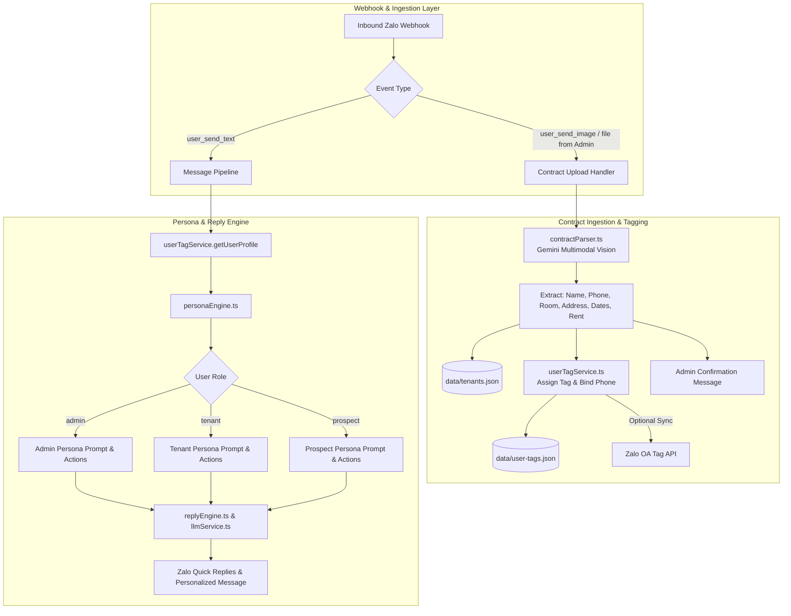

# Design Spec: User Tag Personas & Contract-Based Auto-Tagging

**Date**: 2026-09-04  
**Status**: Approved by User  
**Target File**: `docs/superpowers/specs/2026-09-04-user-tag-personas-and-contract-tagging-design.md`

---

## 1. Goal & Overview

Upgrade the Zalo OA chatbot to dynamically adapt its communication style, prompt instructions, and suggested actions based on three user tag roles:
1. **`admin`**: Concise, operational, executive commands and metrics (e.g. system status, pending tickets, contract upload confirmation).
2. **`tenant`** (Current Resident tagged with room number and building address, e.g. "Phòng 302 - 123 Lê Lợi"): Warm, respectful, resident-focused concierge addressing their specific room/building, prioritizing maintenance tickets, bills, house rules, and emergency hotlines.
3. **`prospect`** (Prospective Client / Untagged): Hospitable, enthusiastic, consultative sales tone highlighting vacant rooms, rental pricing, amenities, viewing appointments, and leasing contacts.

Additionally, provide an automated ingestion pipeline where an Admin can upload a rental contract (Image/PDF via Zalo chat or REST API). The chatbot automatically extracts tenant details (tenant name, phone, room, address, rental duration, price) using Gemini Multimodal Vision, records the contract in a local registry, and automatically assigns the tenant tag to any matching user (with Zalo OA Tagging API synchronization).

---

## 2. Architecture & Component Decomposition



### Module Responsibilities:
1. **`src/tags/userTagService.ts`**:
   - Manages user profiles, role tags (`admin`, `tenant`, `prospect`), room numbers, building addresses, and phone mappings.
   - Handles persistent storage in `data/user-tags.json` and `data/tenants.json`.
   - Binds phone numbers to Zalo User IDs upon message extraction or explicit phone input.
   - Syncs tag updates to Zalo OA Tag API (`POST https://openapi.zalo.me/v3.0/oa/tag/taguser`).
2. **`src/contracts/contractParser.ts`**:
   - Downloads image/PDF buffers from Zalo attachment URLs or REST endpoints.
   - Calls Gemini 1.5/2.0 Flash Multimodal API with strict structured schema output.
   - Returns sanitized contract metadata.
3. **`src/personas/personaEngine.ts`**:
   - Defines persona prompt instructions, greeting adapters, tone rules, and role-based quick reply button sets for `admin`, `tenant`, and `prospect`.
4. **`src/replyEngine.ts` & `src/llm/llmService.ts`**:
   - Retrieves `UserTagProfile` for each incoming message.
   - Formats rule-based replies and injects persona instructions into multi-turn Gemini LLM fallback.
5. **`src/server.ts`**:
   - Handles `user_send_image` and `user_send_file` events from Admin users, forwarding them to the contract parser.
   - Exposes `POST /api/contracts/upload` for multipart or base64 uploads.

---

## 3. Data Model & Storage Schema

### `data/user-tags.json`
```typescript
export type UserRole = "admin" | "tenant" | "prospect";

export interface UserTagProfile {
    zaloUserId: string;
    role: UserRole;
    phone?: string;
    roomNumber?: string;
    address?: string;
    tenantName?: string;
    assignedAt: number;
    syncedToZaloOA?: boolean;
}

export type UserTagStore = Record<string, UserTagProfile>;
```

### `data/tenants.json`
```typescript
export interface TenantContractRecord {
    contractId: string;
    tenantName: string;
    phone: string;              // Standardized Vietnamese phone (e.g. 0912345678)
    roomNumber: string;         // e.g. "302"
    address: string;            // e.g. "123 Lê Lợi, P. Bến Thành, Q.1"
    startDate?: string;
    endDate?: string;
    monthlyRent?: string;
    status: "active" | "expired" | "terminated";
    createdAt: number;
}

export type TenantRegistry = Record<string, TenantContractRecord>; // Keyed by normalized phone
```

---

## 4. Contract Ingestion & Parsing Workflow

### 4.1 Triggering Contract Parsing
- **Zalo Chat Attachment**:
  When `event.event_name === "user_send_image"` or `event.event_name === "user_send_file"`, inspect `event.sender.id`:
  - If `getUserProfile(senderId).role === "admin"`:
    - Retrieve attachment URL from `event.message.attachments` or `event.message.url`.
    - Fetch image/PDF buffer via `axios.get(attachmentUrl, { responseType: "arraybuffer" })`.
    - Process with `contractParser.parseRentalContract(buffer, mimeType)`.
    - If valid: Save contract to `tenants.json`, trigger `assignTagToPhone(...)`, and send confirmation reply.
  - If not admin: Forward image to normal customer support / ticket handler.

- **REST API Endpoint (`POST /api/contracts/upload`)**:
  - Middleware receives multipart file or JSON with base64 data.
  - Authenticates request (Admin bearer token / local secret).
  - Processes file buffer and returns JSON response with parsed contract and tag assignment status.

### 4.2 Multimodal Contract Extraction Prompt
```text
Bạn là chuyên gia phân tích hợp đồng thuê nhà tại Việt Nam.
Hãy đọc kỹ hình ảnh/tài liệu hợp đồng đính kèm và trích xuất thông tin theo định dạng JSON chuẩn sau:
{
  "tenantName": string | null,    // Họ tên người thuê (Bên B)
  "phone": string | null,         // Số điện thoại người thuê (chuẩn hóa 10 chữ số)
  "roomNumber": string | null,    // Số phòng thuê (ví dụ: "302", "P.101")
  "address": string | null,       // Địa chỉ tòa nhà/nhà trọ
  "startDate": string | null,     // Ngày bắt đầu hợp đồng (YYYY-MM-DD hoặc DD/MM/YYYY)
  "endDate": string | null,       // Ngày kết thúc hợp đồng
  "monthlyRent": string | null    // Giá thuê hàng tháng (ví dụ: "8,000,000 đ/tháng")
}
Lưu ý: Chỉ trả về định dạng JSON thuần túy, không thêm markdown ticks thừa ngoài JSON.
```

### 4.3 Tag Assignment & Phone Binding Logic
1. When contract is saved for `phone`:
   - Search `data/user-tags.json` for any profile where `profile.phone === phone`.
   - If found:
     - Update profile: `role = "tenant"`, `roomNumber = contract.roomNumber`, `address = contract.address`, `tenantName = contract.tenantName`.
     - Sync tag to Zalo OA Tag API (`syncTagToZaloOA(profile.zaloUserId, `Cư dân - P.${contract.roomNumber}`)`).
2. When an untagged user sends a message containing a phone number or interacts with the bot:
   - Extract phone from message via existing phone regex.
   - Look up phone in `data/tenants.json`.
   - If active contract exists: Bind `zaloUserId` $\leftrightarrow$ `phone`, upgrade role to `"tenant"`, set room and address.

---

## 5. Persona Engine & Communication Style Specifications

### 5.1 Admin Persona
- **Criteria**: `zaloUserId === ADMIN_ZALO_USER_ID` or role is `"admin"`.
- **Tone**: Concise, operational, executive summaries, command-oriented.
- **LLM System Instruction**:
  ```text
  Bạn đang trò chuyện với ADMIN / QUẢN LÝ TÒA NHÀ.
  Phong cách: Ngắn gọn, súc tích, chuyên nghiệp, tập trung vào số liệu và tác vụ quản trị.
  Hỗ trợ các tác vụ: kiểm tra trạng thái bot, thống kê ticket sự cố, hướng dẫn upload hợp đồng, lệnh điều khiển #pause/#resume.
  Tuyệt đối không chào hỏi dài dòng kiểu tiếp thị hoặc tư vấn thuê phòng.
  ```
- **Recommended Buttons**:
  - `[📊 Trạng thái Bot]`
  - `[🎫 Danh sách Ticket]`
  - `[📄 Hướng dẫn nạp HĐ]`
  - `[⏸️ Tạm dừng Bot]`

### 5.2 Current Tenant Persona
- **Criteria**: Role is `"tenant"`, with bound `roomNumber` and `address`.
- **Tone**: Warm, respectful, resident-focused concierge.
- **Greeting Pattern**: *"Dạ em chào anh/chị phòng [roomNumber] tòa [address] ạ!"*
- **LLM System Instruction**:
  ```text
  Bạn là Quản Gia Tòa Nhà hỗ trợ CƯ DÂN ĐANG THUÊ PHÒNG.
  Người dùng hiện đang ở: Phòng {{roomNumber}} - Địa chỉ {{address}}.
  Phong cách: Lịch sự, chu đáo, nhiệt tình, xưng "em", gọi người dùng là "anh/chị".
  Ưu tiên hỗ trợ: Báo hỏng thiết bị/sửa chữa (tự động ghi nhận số phòng {{roomNumber}}), thanh toán tiền phòng/điện nước, nội quy tòa nhà, gửi xe, hotline quản lý.
  Tuyệt đối không tư vấn bán/cho thuê phòng mới trừ khi cư dân chủ động hỏi thuê thêm phòng.
  ```
- **Recommended Buttons**:
  - `[🔧 Báo sự cố phòng]`
  - `[💳 Thanh toán tiền phòng]`
  - `[📜 Nội quy tòa nhà]`
  - `[📞 Hotline Ban Quản Lý]`

### 5.3 Prospective Client Persona
- **Criteria**: Untagged user / role is `"prospect"`.
- **Tone**: Enthusiastic, hospitable, sales & consultative advisory.
- **Greeting Pattern**: *"Dạ Quản Gia Tòa Nhà xin chào bạn! Rất vui được đồng hành cùng bạn tìm kiếm căn phòng ưng ý ạ..."*
- **LLM System Instruction**:
  ```text
  Bạn là Quản Gia & Chuyên viên tư vấn cho KHÁCH HÀNG ĐANG TÌM THUÊ PHÒNG.
  Phong cách: Nhiệt tình, thân thiện, hiếu khách, phong cách tư vấn chuyên nghiệp.
  Ưu tiên hỗ trợ: Giới thiệu phòng trống, bảng giá thuê, tiện ích tòa nhà (wifi, máy giặt, an ninh, giờ giấc tự do), đặt lịch hẹn xem phòng trực tiếp, thủ tục cọc và làm hợp đồng.
  Nếu khách muốn xem phòng hoặc chốt phòng, hãy khuyến khích khách để lại số điện thoại hoặc liên hệ hotline để nhận ưu đãi.
  ```
- **Recommended Buttons**:
  - `[🏠 Xem danh sách phòng]`
  - `[💰 Bảng giá thuê phòng]`
  - `[📅 Đặt lịch xem phòng]`
  - `[📞 Gặp tư vấn viên]`

---

## 6. Integration Points

1. **[`src/server.ts`](file:///D:/Học tập/thenewzalooa/Chatbot/src/server.ts)**:
   - Intercepts `user_send_image` and `user_send_file` from Admin users $\rightarrow$ forwards to `handleContractUpload`.
   - Exposes `/api/contracts/upload` REST endpoint.
2. **[`src/replyEngine.ts`](file:///D:/Học tập/thenewzalooa/Chatbot/src/replyEngine.ts)**:
   - Calls `userTagService.getUserProfile(userId)` before processing.
   - If user is `tenant`, pre-populates `session.roomNumber` with `profile.roomNumber`.
   - Injects persona framing into replies and selects role-specific `recommendedButtons`.
3. **[`src/llm/llmService.ts`](file:///D:/Học tập/thenewzalooa/Chatbot/src/llm/llmService.ts)**:
   - Receives `UserTagProfile` and appends role-specific persona instructions to the Gemini system prompt.
4. **[`src/zaloClient.ts`](file:///D:/Học tập/thenewzalooa/Chatbot/src/zaloClient.ts)**:
   - Adds helper `syncUserTagToZaloOA(userId, tagName)` calling Zalo OpenAPI v3.0 Tagging endpoints.

---

## 7. Testing & Verification Plan

1. **Unit Tests (`scripts/testUserTags.ts`)**:
   - Test default prospect role for new users.
   - Test admin detection via config and tag store.
   - Test contract ingestion into `tenants.json`.
   - Test phone binding: when prospect provides phone, profile auto-upgrades to tenant with correct room & address.
2. **Contract Parser Tests (`scripts/testContractParser.ts`)**:
   - Mock/Live test Gemini Vision on sample contract image/PDF.
   - Verify extracted JSON fields (phone, room, address, rent).
3. **Persona Adaptation Tests (`scripts/testPersonaStyles.ts`)**:
   - Verify Admin gets operational response and admin buttons.
   - Verify Tenant gets room-personalized warm response and resident buttons.
   - Verify Prospect gets consultative sales response and viewing buttons.

---

## 8. Self-Review Checklist
- [x] **Spec coverage**: Covers all requirements (admin/tenant/prospect styles, contract upload, Gemini multimodal extraction, auto-tagging by phone, Zalo OA sync).
- [x] **Placeholder scan**: No TBDs, TODOs, or unwritten logic.
- [x] **Internal consistency**: Data models and method signatures match across sections.
- [x] **Scope check**: Well-bounded, modular design following existing repo conventions.
- [x] **Ambiguity check**: Clear rules for handling missing phones, unbound Zalo users, and non-admin uploads.
